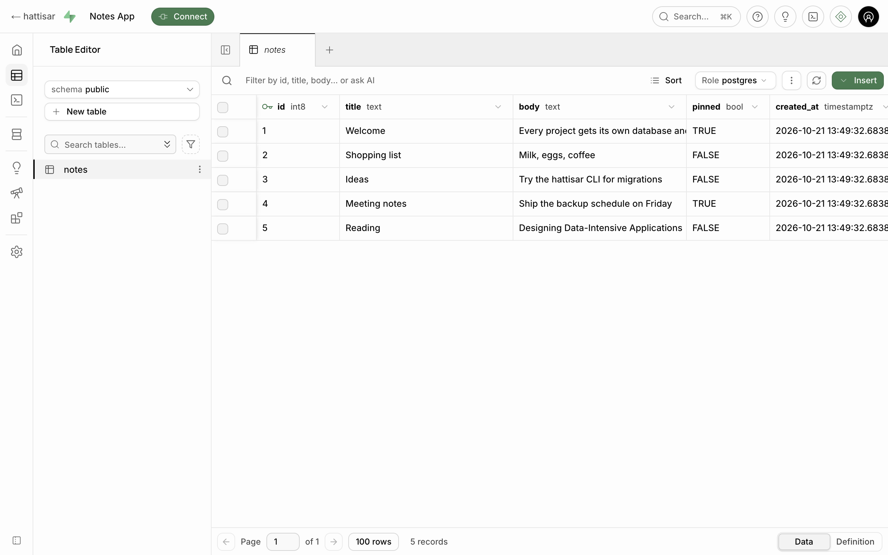
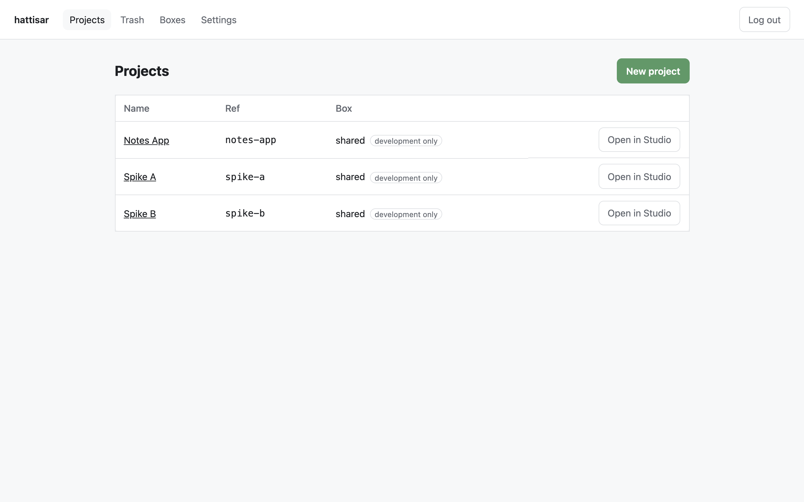
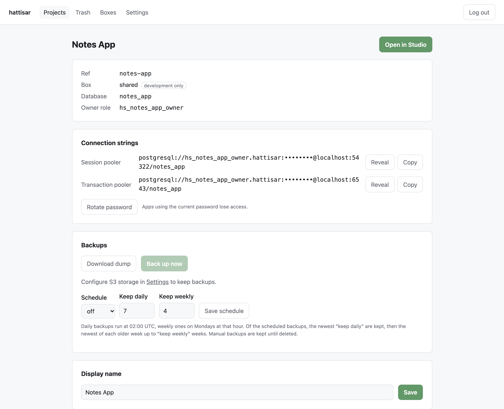
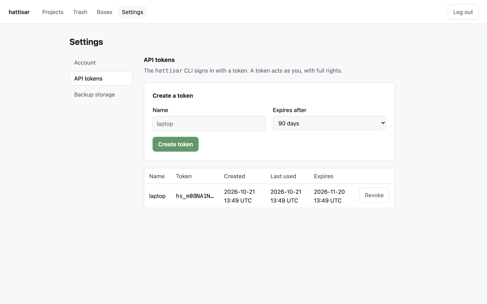

# hattisar

*हात्तीसार — an elephant stable: the place many Postgres elephants are kept.*

Multi-project databases for **self-hosted Supabase Studio**. Self-hosted Supabase gives you one
project; hattisar puts many databases behind one Studio and one login — on a shared dev box or on
dedicated boxes — with connection strings, backups to S3, and soft delete.

One stock, unmodified Studio serves every project. hattisar sits in front of it and picks the
database per request, so opening `/project/notes-app/editor` shows `notes-app`'s tables and
nothing else.

> Not affiliated with Supabase. "Supabase" is used only to name the software hattisar works with.

## What you get

- **Projects** — a project is a Postgres database plus its own owner role, created in seconds.
- **Boxes** — the Postgres servers projects live on: the bundled *shared* box (development only),
  any *registered* Postgres you already run, or a *managed* box hattisar starts in Docker.
- **Studio** — the real Supabase Studio, per project: Table Editor, SQL editor, database screens.
- **Connection strings** — pooler (session and transaction) strings through one Supavisor for the
  shared box, managed boxes and registered boxes without TLS, plus direct strings for every box but
  the shared one; reveal, copy, rotate.
- **Backups** — download a `pg_dump`, back up to S3 now or on a daily/weekly schedule with
  retention, restore into the same project or a new one.
- **Soft delete** — deleted projects go to Trash and can be restored until they are purged
  (7 days by default).

### Screenshots

Studio's Table Editor on one project, with hattisar's "← hattisar" link back:



| Projects | Project page |
|---|---|
|  |  |

Settings → API tokens, for the [CLI](#cli):



## Quick start (development)

Needs Docker, Node 24 and pnpm 11 (`corepack enable`), and free host ports 8000, 54322 and 6543.

```sh
pnpm install
pnpm stack:up        # writes docker/.env with generated secrets, builds and starts the stack
```

Open <http://localhost:8000> and log in as `admin` with the password from
`grep HATTISAR_ADMIN_PASSWORD docker/.env`. Create a project on the shared box, open it in Studio,
and copy its pooler connection string into an app.

The development stack mounts `src/` into the hattisar container (`pnpm dev`, reloads on change),
turns managed boxes on, and runs an S3-compatible test service reachable inside the compose
network as `http://s3:9000` (bucket `hattisar-test`, keys `S3_TEST_*` in `docker/.env`, path-style
on) — enough to try backups from Settings.

```sh
pnpm lint && pnpm typecheck && pnpm test     # unit
pnpm test:it                                 # integration, needs the stack
pnpm exec playwright install chromium
pnpm test:e2e                                # end to end, needs the stack
pnpm stack:down                              # add -v to drop the volumes too
```

`scripts/dev-env.sh` never overwrites `docker/.env`. The admin password is read only on the first
boot of an empty `hattisar-data` volume; change it afterwards in Settings.

## CLI

`hattisar` drives projects, connection URLs and backups from a terminal or CI, through the JSON
API under `/_hs/api/v1`. It needs Node 24 and has no dependencies:

```sh
npm install -g hattisar             # or: npx hattisar, or from source: pnpm build:cli
```

Create a token in Settings → API tokens, then:

```sh
hattisar login https://hattisar.example.com     # paste the token; it is never an argument
hattisar projects create "Notes App"            # ref notes-app, on the shared box
psql "$(hattisar projects url notes-app)"
hattisar backups run notes-app
hattisar projects delete notes-app --confirm notes-app
```

```text
$ hattisar projects list
REF        NAME       BOX     CREATED
notes-app  Notes App  shared  2026-10-21 13:49 UTC
```

To release the CLI, bump `version` in `cli/package.json` through a PR, then tag the merged commit:

```sh
git tag cli-v0.2.0 && git push origin cli-v0.2.0   # tests, publishes to npm, creates the GitHub release
```

Server releases work the same way: bump `version` in `package.json` through a PR, then tag the
merged commit `v<version>`. That publishes the image, the compose bundle and `install.sh`. After
the first release, make the GHCR package public once in its package settings; the first run fails
its public-pull check until then, so re-run the job.

```sh
git tag v0.1.0 && git push origin v0.1.0   # tests, pushes the image, creates the GitHub release
```

Migrations stay with the official Supabase CLI:

```sh
supabase db push --db-url "$(hattisar projects url <ref>)"
```

`HATTISAR_URL` and `HATTISAR_TOKEN` replace `login` in CI. Every command and exit code is in
[`cli/README.md`](cli/README.md).

## How it works

```
browser ──► hattisar :8000 ──► studio:3000 (internal only)
              │                     │
              │                     └──► meta:8080 ──► box (any registered Postgres)
              ├─► meta:8080  (hattisar's own /query handling)
              ├─► boxes      (admin ops: create db/role, dumps)
              ├─► S3         (backups)
              ├─► supavisor:4000 (tenant API)
              └─► docker-socket-proxy (only when managed boxes are on)
apps ──► supavisor :54322/:6543 ──► boxes with a pooler tenant
apps ──► box public host/port   ──► any non-shared box directly
```

Studio reaches a database through postgres-meta, which connects wherever the encrypted
`x-connection-encrypted` header tells it to. hattisar answers Studio's project API itself, runs
Studio's SQL queries against the project's database, and sets that header on every other pg-meta
request for the project in the URL. Studio and postgres-meta are configured with a default
database that exists nowhere (`hattisar_no_project`), so a Studio route hattisar does not redirect
— including one a future Studio adds — fails instead of reading another project's data.

The stack (`docker/compose.yml`) is `db` (the shared box, `supabase/postgres`), `meta`, `studio`,
`supavisor` (one pooler tenant per box, registered by hattisar through Supavisor's API) and
`hattisar`, plus `docker-proxy` under the `managed-boxes` profile. Only hattisar, the pooler and
managed boxes publish host ports. hattisar keeps its own state in SQLite in the `hattisar-data`
volume. The full design is in [`docs/design.md`](docs/design.md).

## Configuration

Set in `.env` next to `compose.yml` (`docker/.env` in a checkout; template:
[`docker/env.example`](docker/env.example)).

| Env | Default | Notes |
|---|---|---|
| `HATTISAR_VERSION` | the bundle's version | hattisar image tag (`latest` in a checkout's `compose.yml`). Prefer upgrading by replacing the bundle over setting it. |
| `HATTISAR_SECRET_KEY` | — | Required, ≥ 32 chars. Encrypts stored secrets (box passwords, owner passwords, S3 secret). Losing it loses them. |
| `HATTISAR_ADMIN_USERNAME` | `admin` | First boot only. |
| `HATTISAR_ADMIN_PASSWORD` | — | Required on first boot, ≥ 12 chars. Ignored afterwards. |
| `HATTISAR_PUBLIC_HOST` | `localhost` | Host shown in connection strings. |
| `HATTISAR_PORT` | `8000` | Host-published port; the app listens on 8000 inside the container. |
| `HATTISAR_BIND` | `0.0.0.0` | Host address `HATTISAR_PORT` is published on. The installer sets `127.0.0.1`. |
| `HATTISAR_DOMAIN` | — | Domain the `caddy` profile serves over HTTPS with a Let's Encrypt certificate, proxying to hattisar. |
| `HATTISAR_DATA_DIR` | `/data` | SQLite registry and temporary restore files. |
| `HATTISAR_COOKIE_SECURE` | `false` | `true` behind HTTPS. |
| `HATTISAR_PURGE_AFTER_DAYS` | `7` | Deleted projects are purged after this many days. |
| `HATTISAR_BACKUP_HOUR_UTC` | `2` | Hour scheduled backups run (weekly ones on Mondays). |
| `HATTISAR_PG_BIN_DIR` | `/usr/bin` | Where `pg_dump`/`pg_restore` live (the image ships PostgreSQL 17 client). |
| `HATTISAR_MANAGED_BOXES` | `false` | Turns managed boxes on; also start the `managed-boxes` profile. |
| `HATTISAR_MANAGED_PORT_RANGE` | `55000-55999` | Host ports for managed boxes. |
| `DOCKER_HOST` | `tcp://docker-proxy:2375` | Managed boxes only. Compose sets it to the proxy; the host's value is never used. |
| `STUDIO_URL` | `http://studio:3000` | |
| `PG_META_URL` | `http://meta:8080` | |
| `PG_META_CRYPTO_KEY` | — | Shared by hattisar, Studio and postgres-meta. |
| `HATTISAR_PG_META_TIMEOUT_SECONDS` | `120` | How long hattisar waits for postgres-meta on SQL editor queries and type generation before answering 504. The timeout only stops hattisar waiting; postgres-meta keeps running the statement until its own query timeout. |
| `POSTGRES_PASSWORD` | — | Admin password of the shared box. |
| `POOLER_TENANT_ID` | — | Shared box pooler tenant, and the prefix of every other box's tenant (`<id>-<box name>`); part of the pooler user name. |
| `POOLER_PORT_SESSION` | `54322` | Pooler, session mode, for every box with a tenant. |
| `POOLER_PORT_TRANSACTION` | `6543` | Pooler, transaction mode, for every box with a tenant. |
| `POOLER_JWT_SECRET` | — | Signs hattisar's calls to Supavisor's tenant API; generated by `scripts/dev-env.sh`. |
| `POOLER_SECRET_KEY_BASE`, `POOLER_VAULT_ENC_KEY` | — | Supavisor's own secrets; generated by `scripts/dev-env.sh`. |

S3 settings are not environment variables: set them in Settings (endpoint for S3-compatible
stores, region, bucket, keys, path style, key prefix). The secret key is stored encrypted.

## Production

Production runs `docker/compose.yml` without the development override. The hattisar image is
published to `ghcr.io/itsbohara/hattisar`.

### Install

On a Linux server (`x86_64` or `aarch64`) with curl, openssl, Docker and Compose v2:

```sh
curl -fsSL https://github.com/itsbohara/hattisar/releases/latest/download/install.sh | sudo sh
```

It asks for a domain and whether to turn managed boxes on (the default, and what `--yes` picks;
pass `--no-managed-boxes` to keep them off), installs into `/opt/hattisar`, and prints the URL
and admin password. To answer up front:

```sh
curl -fsSL https://github.com/itsbohara/hattisar/releases/latest/download/install.sh \
  | sudo sh -s -- --domain hattisar.example.com --yes
```

With a domain, Caddy serves it over HTTPS with a Let's Encrypt certificate (ports 80 and 443 must
reach the server). Without one, hattisar listens on `127.0.0.1:8000` only: reach it with
`ssh -L 8000:localhost:8000 <server>` or your own proxy to `127.0.0.1:8000`. To upgrade, run the
same command again; it backs up the registry first and only adds new keys to `.env`. Every
option is in [`docs/design.md` §17](docs/design.md#17-installer).

Don't install on a Docker host that also runs a checkout's `pnpm stack:up`: both use the compose
project `hattisar`, so they would share containers and volumes.

### From a release by hand

Nothing is built. Download `hattisar-<version>.tar.gz` from the
[GitHub release](https://github.com/itsbohara/hattisar/releases), then:

```sh
tar -xzf hattisar-<version>.tar.gz && cd hattisar
sh generate-env.sh env.example .env   # fresh secrets; then review .env
docker compose up -d
```

### From a checkout

Builds the image from [`docker/Dockerfile`](docker/Dockerfile):

```sh
sh scripts/dev-env.sh     # generate docker/.env with fresh secrets, then edit it
docker compose -f docker/compose.yml -f docker/compose.source.yml up -d --build
```

Before exposing it:

- **TLS** — the installer's domain option sets this up (Caddy, `HATTISAR_BIND=127.0.0.1`).
  Otherwise put hattisar behind a reverse proxy that terminates HTTPS (Caddy, nginx, Traefik) and
  set `HATTISAR_COOKIE_SECURE=true`. Compose publishes `HATTISAR_PORT` on `HATTISAR_BIND`, every
  interface by default; set it to `127.0.0.1` or firewall the port so only the proxy reaches it.
  The proxy must pass the browser's `Host` header through unchanged: hattisar compares it with
  `Origin` on every POST, and answers a mismatch with 403.
- **Public host** — set `HATTISAR_PUBLIC_HOST` to the name apps use to reach the boxes; it goes
  into every connection string.
- **Pooler ports** — 54322 and 6543 are published for apps on every box with a pooler tenant.
  Clients reach them without TLS, which is why registered boxes that require TLS get no tenant.
  Close them if no app should connect from outside.
- **Secrets** — keep a copy of `.env` (`docker/.env` in a checkout). Without
  `HATTISAR_SECRET_KEY` the stored box and S3 credentials cannot be decrypted.
- **Backups** — configure S3 in Settings, set a schedule per project, and use "Test connection".
  Back up the `hattisar-data` volume too: it is the registry of boxes and projects.
- **PITR** — dumps restore to the moment of the dump. For production boxes also run box-level
  point-in-time recovery: [`docs/pitr.md`](docs/pitr.md) is a WAL-G recipe for managed boxes.
- **Shared box** — development only. Put production projects on a registered or managed box.
- **Managed boxes** — off in a hand install, on by default with the installer; see the security
  note below.

To upgrade an install, run the installer again. To upgrade a release by hand, replace
`compose.yml`, `volumes/` and `generate-env.sh` with the ones from the new bundle, compare
`env.example` with `.env` for new keys, then run `docker compose pull && docker compose up -d`.
To upgrade a checkout, pull and run the same `up -d --build`. Registry migrations run at boot.
Upgrading the pinned Studio and Postgres images is covered in
[`docs/upgrading-studio.md`](docs/upgrading-studio.md).

## Security model

- **One admin.** A single user logs in (scrypt password hash, `HttpOnly` session cookie, 7-day
  sessions, 5 failed logins per 15 minutes, `Origin`/`Referer` check on every state-changing request,
  Studio's API calls included). Every
  project-scoped path goes through one authorization check; in v1 the admin sees everything.
- **One owner role per project.** Creating a project creates `hs_<db>_owner` with a random
  password and a database it owns. `CONNECT` and `TEMPORARY` on the database are revoked from
  `PUBLIC` and granted to the owner alone, so a project's role cannot connect to another project's
  database.
- **Studio connects as the project's owner**, the same role apps use. Tables made in Studio belong
  to the role your app logs in as. Studio actions that need a superuser (untrusted extensions,
  role management) fail with a permission error. hattisar's own admin operations (create, delete,
  backup, restore) use the box admin.
- **No silent default database.** Every postgres-meta request carries the connection hattisar
  chose for the ref in the URL; a ref it cannot resolve is a 404, and anything that slips past
  lands on a database that does not exist.
- **Shared box = development only.** All its projects share one Postgres server and one superuser,
  and every role can connect to its `postgres`, `_supabase` and `template1` databases (Postgres
  grants `CONNECT` on them to `PUBLIC`; owner roles cannot create anything there). Use dedicated
  boxes for production.
- **Secrets at rest** are encrypted with AES-256-GCM under `HATTISAR_SECRET_KEY` and never written
  to logs, error messages or command lines.
- **Internal services stay internal.** Studio, postgres-meta and the shared box publish no host
  ports; only hattisar, the pooler and managed boxes do.

## Backups

- **Download dump** streams `pg_dump -Fc` of the project's database.
- **Back up now** and **schedules** (daily or weekly at `HATTISAR_BACKUP_HOUR_UTC`) write custom
  format dumps to `<prefix>/<ref>/` in your S3 bucket. Scheduled backups keep the newest 7 dailies
  and one per week for 4 weeks by default; manual backups stay until you delete them.
- **Restore** a backup into the same project (drops and recreates its database, same owner and
  password) or into a new project.
- **SQL snippets** belong to their project and live in the registry, so they are backed up with
  the `hattisar-data` volume, not in the project's dump.

**Backups are not point-in-time recovery.** A restore returns the database to the moment the dump
was taken; everything written since is lost. Production boxes also need box-level PITR: see
[`docs/pitr.md`](docs/pitr.md), which restores a whole box, not one project.

## Managed boxes

With managed boxes on, "New managed box" (Boxes) and "New dedicated box" (New project) start a
fresh `supabase/postgres` container per box, with its own volume and a host port from
`HATTISAR_MANAGED_PORT_RANGE`. To turn them on, set `HATTISAR_MANAGED_BOXES=true` in `.env`
(`docker/.env` in a checkout) and start the profile:

```sh
docker compose --profile managed-boxes up -d     # from a release
docker compose -f docker/compose.yml -f docker/compose.source.yml --profile managed-boxes up -d --build
```

hattisar reaches Docker only through `docker-proxy` (tecnativa/docker-socket-proxy) on an internal
network, and only lists, starts, stops and removes containers and volumes labelled
`hattisar.managed=true`.

**Security note:** the socket proxy allows creating containers. Whoever controls hattisar — its
admin login, or code running in its container — can therefore start a container with any mount,
which is equivalent to root on the Docker host. Turn managed boxes on only where that is
acceptable.

## Known limitations

- **Single admin.** No multiple users or per-project access in v1.
- **No pooler for registered boxes that require TLS.** Supavisor here takes clients without TLS, so
  a registered box with `sslmode` `require` or `verify-full` gets direct connection strings only.
- **Shared box `postgres`, `_supabase` and `template1` databases** are reachable by every role on
  that box (see Security model).
- **Superuser-only Studio actions** fail, because Studio connects as the project's owner.
- **Studio features hattisar does not serve** are hidden or answered with 404: Authentication,
  Storage, Edge Functions, Realtime, AI assistance, migrations, MCP. Advisors always show no lints.
- **Backups are not PITR** (for that, see [`docs/pitr.md`](docs/pitr.md)). A restore needs free disk in `HATTISAR_DATA_DIR` about the size of the
  dump. Objects you added yourself to a project's `extensions` schema are not restored. A backup
  to S3 is uploaded in 5 MiB parts, at most 10,000 of them, so a dump larger than about 48 GB
  fails; use the download instead.
- **Managed boxes:** the box admin password is in the container's environment (visible to anyone
  with Docker access). Postgres's encryption root key lives in the container, not the volume, so
  recreating a managed box's container by hand (for example to upgrade its image) loses
  Vault-encrypted data. Upgrading managed boxes is not supported in v1.
- **Boxes on other Docker hosts**, plain-Postgres boxes, and Auth/REST/Storage per project are out
  of scope for v1.

## Upgrading Studio

Studio, postgres-meta, Postgres and Supavisor are pinned to one official self-hosted release.
Bumping any of them needs the routing end-to-end test to pass — see
[`docs/upgrading-studio.md`](docs/upgrading-studio.md).

## License

[Apache-2.0](LICENSE). `docker/compose.yml` and `docker/volumes/` derive from the Supabase
self-hosted Docker setup, also Apache-2.0 — see [`docker/NOTICE`](docker/NOTICE).

Not affiliated with Supabase.
